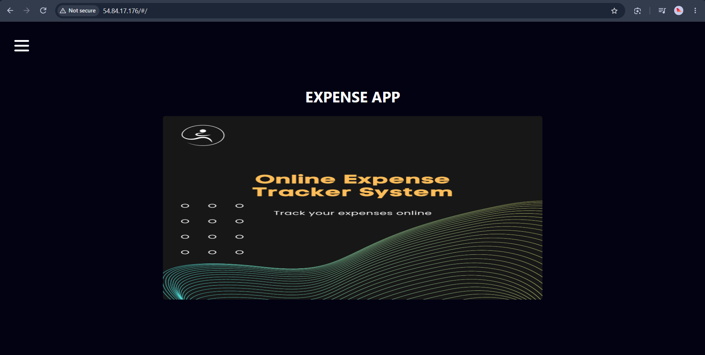
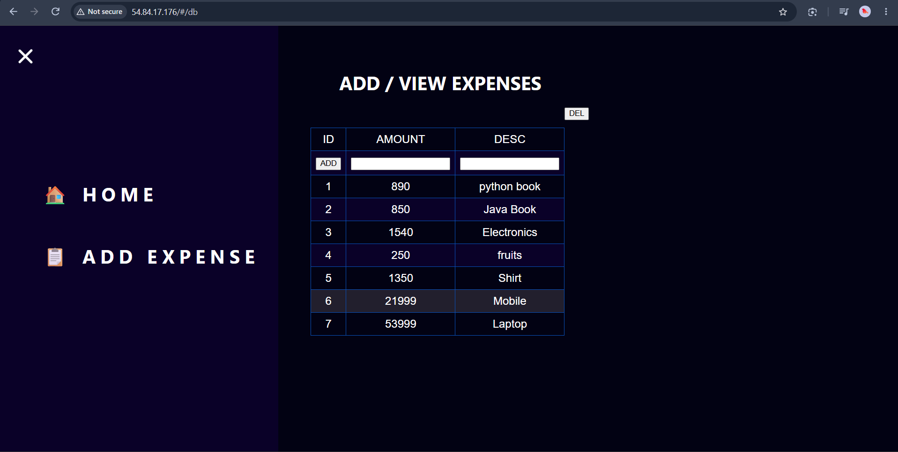
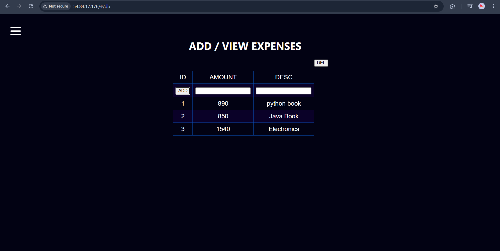

# Expense Management Application

A full-stack Expense Management Application deployed on AWS using a three-tier architecture with separate EC2 instances for the frontend, backend, and database.

## Architecture

```text
                        Internet
                           |
                           v
                  +------------------+
                  |   Frontend EC2   |
                  |  Expense App UI  |
                  +--------+---------+
                           |
                      Private IP
                           |
                           v
                  +------------------+
                  |    Backend EC2   |
                  |    REST API      |
                  +--------+---------+
                           |
                      Private IP
                           |
                           v
                  +------------------+
                  |   Database EC2   |
                  |     Database     |
                  +------------------+
```

## Project Overview

The application is deployed on three separate AWS EC2 instances:

* **Frontend EC2** – Hosts the frontend application.
* **Backend EC2** – Runs the backend application and APIs.
* **Database EC2** – Hosts the application database.
* Frontend communicates with the backend using the backend server's private IP address.
* Backend communicates with the database using the database server's private IP address.
* AWS Security Groups are configured to allow the required communication between the servers.

## Technologies Used

* AWS EC2
* Linux
* Git & GitHub
* Frontend: React
* Backend: Node.js / Express.js
* Database: MongoDB
* Private IP Networking
* AWS Security Groups

## Project Structure

```text
expense-app/
│
├── frontend/
│   └── Frontend application source code
│
├── backend/
│   └── Backend application source code
│
├── app-demo/
│   └── Application screenshots
│
├── .gitignore
└── README.md
```

## AWS Deployment

### 1. EC2 Infrastructure

Created three separate EC2 instances for the application:

```text
Frontend EC2
Backend EC2
Database EC2
```

Each server was configured with the required software and dependencies.

### 2. Database Server

The database was installed and configured on the Database EC2 instance.

The backend connects to the database using the database server's private IP address.

```text
Backend EC2
     |
     | Private IP
     v
Database EC2
```

### 3. Backend Server

The backend application was deployed on the Backend EC2 instance.

The backend was configured to connect to the database using its private IP address.

```text
Database Host = <DATABASE_PRIVATE_IP>
```

### 4. Frontend Server

The frontend application was deployed on the Frontend EC2 instance.

The frontend was configured to communicate with the backend using the backend server's private IP address.

```text
Backend URL = http://<BACKEND_PRIVATE_IP>:<PORT>
```

### 5. Server Communication

The final application flow is:

```text
User
 |
 v
Frontend EC2
 |
 | Private IP
 v
Backend EC2
 |
 | Private IP
 v
Database EC2
```

The application was tested after deployment to verify communication between all three tiers.

## How to Run Locally

### Clone the Repository

```bash
git clone <YOUR_GITHUB_REPOSITORY_URL>
cd expense-app
```

### Run Frontend

```bash
cd frontend
npm install
npm start
```

### Run Backend

Open another terminal:

```bash
cd backend
npm install
npm start
```

Make sure the database is running and the backend database configuration is correctly configured before starting the application.

## AWS Deployment Steps

The general deployment process used for this project was:

```text
1. Create three EC2 instances
          ↓
2. Configure Frontend EC2
          ↓
3. Configure Backend EC2
          ↓
4. Configure Database EC2
          ↓
5. Configure required Security Group rules
          ↓
6. Configure private IP communication
          ↓
7. Deploy frontend application
          ↓
8. Deploy backend application
          ↓
9. Configure database connection
          ↓
10. Test the complete application
```

The application was deployed and tested using SSH-based server access and terminal tools.

## Application Demo

Screenshots of the deployed application are available in the `app-demo` folder.

### Application Dashboard



### Add Expense



### Expense Details



> The screenshots demonstrate the application after successful AWS deployment. The EC2 instances may not remain continuously running because AWS EC2 resources can incur charges.

## Key DevOps / AWS Work

* Created and configured separate EC2 instances for frontend, backend, and database.
* Deployed the application across a three-tier AWS architecture.
* Configured private IP communication between frontend and backend.
* Configured private IP communication between backend and database.
* Configured AWS Security Groups for required network communication.
* Connected and tested the application across multiple EC2 instances.
* Used Git, Git Bash, and SSH-based server management for deployment.

## Security Considerations

Sensitive information is not included in this repository.

The following should never be committed to GitHub:

```text
.env
.env.*
*.pem
*.key
AWS Access Keys
AWS Secret Keys
Database Passwords
Private Credentials
```

Private IP addresses and credentials used during deployment are not included in this repository.

## Future Improvements

* Containerize the application using Docker.
* Automate AWS infrastructure provisioning using Terraform.
* Implement CI/CD using Jenkins.
* Add DevSecOps security scanning.
* Implement application monitoring and centralized logging.
* Explore Kubernetes-based deployment.

# Expense App — Local Setup Guide

This guide explains how to run the Expense App on a local Windows computer using VS Code, Node.js, Express, and MySQL.

> **Important:** These instructions assume the repository's current structure, with the backend in `backend/` and a prebuilt frontend in `frontend/`. The frontend directory contains compiled assets rather than the original React source project. That means you can run the committed frontend locally, but editing individual React components requires recovering or recreating the frontend source.

## 1. Project Structure

```text
expense-app/
├── app-demo/                  # Application screenshots
├── backend/                   # Express API and MySQL database code
│   ├── index.js
│   ├── DbConfig.js
│   ├── TransactionService.js
│   └── package.json
├── frontend/                  # Prebuilt frontend files
└── README.md
```

## 2. Requirements

Install these tools before starting:

- **Node.js LTS**: <https://nodejs.org/en/download>
- **Git**: <https://git-scm.com/downloads>
- **MySQL Server**: <https://dev.mysql.com/downloads/mysql/>
- **Visual Studio Code**: <https://code.visualstudio.com/>
- **MySQL Workbench** (optional, recommended for running SQL): <https://dev.mysql.com/downloads/workbench/>

Open PowerShell or the VS Code terminal and verify Node.js, npm, and Git:

```powershell
node -v
npm -v
git --version
```

Each command should print a version number.

## 3. Clone the Repository

In PowerShell, navigate to the directory where you want to store the project and run:

```powershell
git clone https://github.com/VijayKumar203/expense-app.git
cd expense-app
code .
```

If `code .` is not recognized, open VS Code manually and use **File → Open Folder** to open the `expense-app` folder.

## 4. Set Up the MySQL Database

Start the MySQL Server service. Open MySQL Workbench, connect to your local MySQL server using an administrator account, and execute the following SQL.

### 4.1 Create the database and table

```sql
CREATE DATABASE IF NOT EXISTS transactions;

USE transactions;

CREATE TABLE IF NOT EXISTS transactions (
    id INT NOT NULL AUTO_INCREMENT PRIMARY KEY,
    amount DECIMAL(10, 2) NOT NULL,
    description VARCHAR(255) NOT NULL
);
```

### 4.2 Create a local database user

Run this SQL using your MySQL administrator account:

```sql
CREATE USER IF NOT EXISTS
'expense_local'@'localhost'
IDENTIFIED BY 'LocalOnlyPassword123!';

GRANT SELECT, INSERT, UPDATE, DELETE
ON transactions.*
TO 'expense_local'@'localhost';

FLUSH PRIVILEGES;
```

`LocalOnlyPassword123!` is an example password for local development. Change it to a password of your choice and use the same password in `backend/DbConfig.js` in the next step.

> Use local-only credentials for development. Never commit real database passwords or production credentials to a public repository.

## 5. Configure `backend/DbConfig.js`

In VS Code, open:

```text
backend/DbConfig.js
```

Replace the file contents with the following local-development configuration:

```javascript
module.exports = Object.freeze({
    DB_HOST: 'localhost',
    DB_USER: 'expense_local',
    DB_PWD: 'LocalOnlyPassword123!',
    DB_DATABASE: 'transactions'
});
```

If you changed the password in Step 4.2, replace `LocalOnlyPassword123!` with your chosen password here as well.

Save the file.

## 6. Update `backend/index.js`

Open:

```text
backend/index.js
```

Make the following changes.

### 6.1 Serve the prebuilt frontend

Add this import near the other `require()` statements at the top of the file:

```javascript
const path = require('path');
```

Find the existing middleware setup:

```javascript
app.use(bodyParser.urlencoded({ extended: true }));
app.use(bodyParser.json());
app.use(cors());
```

Add the following immediately after it:

```javascript
app.use(
    express.static(path.join(__dirname, '..', 'frontend'))
);
```

This allows Express to serve the files in the `frontend/` directory.

### 6.2 Align the API paths

The frontend uses `/api/transaction`, while the backend's routes may currently use `/transaction`. In `backend/index.js`, update the route paths so they match the frontend:

| Existing backend route | Updated backend route |
|---|---|
| `app.post('/transaction', ...)` | `app.post('/api/transaction', ...)` |
| `app.get('/transaction', ...)` | `app.get('/api/transaction', ...)` |
| `app.delete('/transaction', ...)` | `app.delete('/api/transaction', ...)` |
| `app.delete('/transaction/id', ...)` | `app.delete('/api/transaction/id', ...)` |
| `app.get('/transaction/id', ...)` | `app.get('/api/transaction/id', ...)` |

Change only the route path strings. Keep the handler functions and their contents unchanged for this step. Save the file.

### 6.3 Fix the status comparison

In `backend/index.js`, look for a condition written like this:

```javascript
if (success = 200)
```

Change it to:

```javascript
if (success === 200)
```

The original uses assignment (`=`), whereas `===` compares values. Review the surrounding handler to ensure the status variable is populated as intended.

## 7. Add the Missing Start Script

Open:

```text
backend/package.json
```

Find the `scripts` section. If it currently looks like this:

```json
"scripts": {
  "test": "echo \"Error: no test specified\" && exit 1"
}
```

Update it to:

```json
"scripts": {
  "start": "node index.js",
  "test": "echo \"Error: no test specified\" && exit 1"
}
```

Keep the other existing fields and dependencies in `package.json`; do not replace the entire file with this snippet. If a `start` script is already present, verify that it runs `node index.js` rather than adding a duplicate.

Save the file.

## 8. Install Dependencies and Start the App

Open the VS Code terminal. From the project root, run:

```powershell
cd backend
npm install
```

Wait for npm to finish installing dependencies. Then start the backend:

```powershell
npm start
```

Keep this terminal open while you use the app. The application is configured to listen on port `8080`.

## 9. Open and Verify the App

Open these addresses in your browser:

- **Application:** <http://localhost:8080>
- **Health check:** <http://localhost:8080/health>
- **Expense API:** <http://localhost:8080/api/transaction>

The health-check endpoint should return its health-check message. If the database and routes are configured correctly, the expense API should return the current records. With an empty table, the response should be similar to:

```json
{"result":[]}
```

The exact response structure depends on the backend handler.

### Test adding an expense

1. Open <http://localhost:8080>.
2. Enter an amount and description, then select **ADD**.
3. Confirm the new expense appears in the application.
4. Refresh the browser and check that the expense is still displayed.
5. In MySQL Workbench, run:

```sql
USE transactions;
SELECT * FROM transactions;
```

The inserted record should appear in the query results.

> **Caution:** The existing `DEL` button may send a DELETE request for the entire transaction collection. Avoid using it while testing if you want to preserve your test records.

## 10. Troubleshooting

| Error or symptom | What to check |
|---|---|
| `Missing script: "start"` | Confirm the `start` script exists in `backend/package.json`. |
| `ER_ACCESS_DENIED_ERROR` | Check `DB_USER`, `DB_PWD`, the MySQL account, and its permissions in `backend/DbConfig.js`. |
| `ECONNREFUSED` or a connection error on port `3306` | Confirm the MySQL Server service is running and listening on the configured port. |
| `ER_BAD_DB_ERROR` | Create the `transactions` database and verify `DB_DATABASE`. |
| `ER_NO_SUCH_TABLE` | Create the `transactions` table using Step 4.1. |
| Frontend loads, but expenses do not appear | Verify that frontend API requests use `/api/transaction`, backend routes match, and the database connection works. Check the browser DevTools Console and Network tabs. |
| `EADDRINUSE: 8080` | Another process is using port `8080`. Stop that process or change the port in the backend, then use the new port in the browser. |
| `Cannot find module ...` | Run `npm install` from the `backend` directory and read the exact missing-module name in the error. |

## 11. Known Limitations and Follow-up Improvements

- The committed `frontend/` directory is a prebuilt bundle rather than a complete React source project. You can run the existing interface, but component-level React changes require the original source code or a recreated source project.
- The backend may return success before the database insert finishes. For a more reliable implementation, update the transaction service and route handlers to wait for database operations and handle errors correctly.
- Review all route handlers and database queries before deploying the application beyond local development.
- Keep database credentials out of source control. For a more secure setup, load credentials from environment variables and provide a local `.env` file that is excluded by `.gitignore`.

## 12. Quick Start Reference

Once the software is installed, the database exists, and the configuration changes above have been saved, the usual startup commands are:

```powershell
# From the repository root
cd backend
npm install
npm start
```

Then open:

```text
http://localhost:8080
```

To stop the local server, focus the terminal running it and press `Ctrl + C`.
